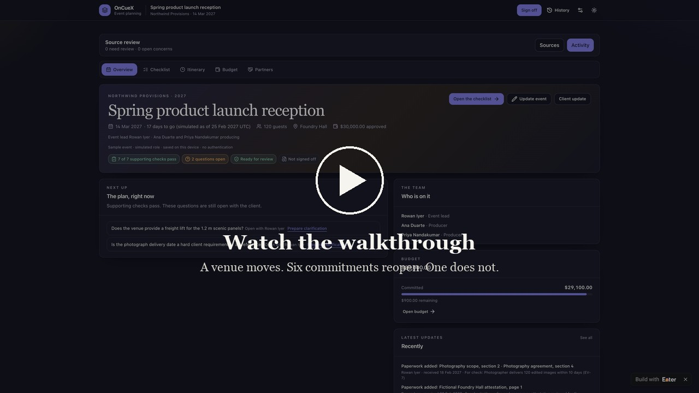

# OnCueX

Event readiness that keeps approval tied to the evidence that supports it.

**Live app:** <https://d606ece3407d419a80272571af62bfd2.prod.enter.pro>
**Demo video:** <https://youtu.be/ag8mpjeWvGY> — 2 min 59 s walkthrough of the deployed app

[](https://youtu.be/ag8mpjeWvGY)

The walkthrough shows the deployed app: the launch at a glance, a venue move that reopens six commitments while leaving the photographer deliverable valid, and the sign-off that becomes history rather than current acceptance. The captioned cut is committed as [submission/oncuex-demo-179s.mp4](submission/oncuex-demo-179s.mp4) with captions in [submission/oncuex-demo.srt](submission/oncuex-demo.srt).

A launch plan is not ready because its tasks are checked off. It is ready when every mandatory requirement has current, attributable support, when the workstreams fit together, and when a project manager accepts that exact state. OnCueX maintains that distinction through a change: when a venue moves, it identifies precisely which commitments the move invalidates, keeps the evidence that never depended on the venue, and refuses to treat an earlier approval as current.

## The scenario

One fictional brand launch: 120 guests, a $30,000 budget, a fixed date. The plan is supported by a venue pack, a crew note, a production note, a photography scope and a budget sheet. The project manager adopts the brief, the integrated review passes, and the milestone is accepted.

The venue then moves from Foundry Hall to Pier 9 Loft. The loading window narrows to 06:00–07:30, licensed occupancy drops to 110, the hard stop moves to 21:30, and the committed total rises to $31,450. Loading, capacity, cost, run of show and the fire attestation become unsupported. The photographer's deliverable — 120 edited images within 10 days — binds to no venue field and stays valid.

Recovery requires current evidence, a re-run review and a new decision. Reverting the venue to Foundry Hall does not restore the earlier approval.

## Readiness and acceptance are separate

Readiness is computed. Each requirement reports as `missing`, `blocked`, `outdated` or `supported` with a named reason, and the integrated checks are reported separately. Acceptance is not computed. It exists only as a decision record made by the project manager against one revision, one requirement set and one evidence set.

A decision is current only while the revision and evidence it references remain current. After a bound fact changes, after expiry, or after a scope change, the decision is returned as historical alongside the named current residuals.

## AI proposes; people adopt

The model extracts a structured brief from pasted text and drafts recovery options. Every extracted claim carries a source reference. Output that fails schema validation, cites a source that is not present, or asserts a confirmation nobody issued is rejected as a proposal and cannot alter the record. Instructions embedded in uploaded material are treated as content, never as authority.

Source review works the same way. Items arrive from named channels with a locator and a content digest; reviewing one records a concern, dismissal, deferral, clarification or resolution without touching assessed project facts. A concern is a separate record from a plan change, and the two are never merged.

## Scope

OnCueX provides:

- A versioned brief with requirements, owners, dependencies, open questions and source-linked evidence.
- Deterministic readiness with named residuals, alongside integrated checks reported separately.
- Reviewed AI extraction and recovery drafting.
- A revision-bound project-manager decision with retained history.
- Source review that records a reviewer's disposition without mutating the plan.
- Reloadable, exportable records, and a working brief and readiness report rendered from reviewed state.

OnCueX does not provide:

- Production authentication, tenancy or multi-user security. Contributor roles are simulated and labeled.
- Marketplace search, live vendor outreach, booking, payments, permit adjudication or CRM integration.
- Multilingual output, graph animation or decorative reporting.
- Verification of physical reality. It checks records, dates and internal consistency; safety, accessibility and permit determinations remain with qualified people.

All people, venues, vendors and prices are fictional. No customer data, contracts or payment details are used.

## Two implementations

The repository holds the same contract twice, deliberately.

| Path | Form | Role |
| --- | --- | --- |
| `oncuex/`, `tools/` | Python, headless | **Normative reference.** Every rule in `docs/` is executed here. Readiness can be re-derived from the record with no model in the loop. |
| `app/` | React + TypeScript, on Enter | **Shipped product.** A port of the same engine behind the operator interface. |

The Python reference decides what is correct. The app is held to it, and the parity checks that prove this are named in [docs/verification.md](docs/verification.md#app-parity).

`oncuex/schema.py` and `app/src/oncuex/schema.ts` are each the single declaration of every bindable path and record shape for their side; the engine and the fixture validator import it rather than repeating it.

## Run the reference

```sh
python3 tools/validate_fixtures.py   # schema, bindings, evidence, oracle coherence
python3 tools/check_schema.py        # executable schema checks, positive and negative
python3 tools/check_core.py          # readiness, currentness and selective impact
python3 tools/check_oracle.py        # 40 differential checks against the oracle
python3 tools/reference_path.py      # baseline -> change -> recovery -> acceptance -> reload
```

`tools/reference_path.py` exercises the end-to-end path and asserts that a decision stays current through an immediate readback and a reload, that the venue change reopens exactly six requirements while the photographer deliverable stays supported, that a retried command appends nothing, and that a rejected write leaves the exported record byte-identical.

## Run the app

Built with [Enter](https://enter.pro). Requires Node 18+ and pnpm.

```sh
cd app
pnpm install
pnpm dev          # http://localhost:8080
pnpm check        # lint + typecheck
pnpm build:prod   # production build
```

Two harnesses run from the same entry, `app/src/oncuex/verification-entry.ts`:

- `runSelfChecks()` — the contract behaviours, including the parity checks below.
- `runSourceReviewChecks()` — the review workflow, including that accepting a concern leaves the exported project byte-identical.

The operator interface has five tabs — Overview, Checklist, Itinerary, Budget, Partners — with sign-off in the header, an activity timeline drawer and a settings dialog.

The AI path calls a hosted Supabase function whose URL and anon key are declared in `src/integrations/supabase/client.ts`; the model credential is held server-side, not in this repository. If the call fails the action reports the error and nothing else is affected — the plan, the record and every deterministic check continue to work without it. The anon key is public by design; row-level security is the boundary, and the function should be reviewed before any non-fictional deployment.

## App parity

The app is a port, so the two engine behaviours most easily lost in a port are pinned by name in the app's own harness. Each is verified load-bearing by reverting the guard and confirming the specific check fails.

| Behaviour | Why it matters | Check |
| --- | --- | --- |
| A prerequisite conflict is prepended, not substituted | The conflict explains why a requirement cannot be satisfied; the evidence gap is what still needs work once it is resolved. Reporting only the conflict discards a true secondary finding. | *A conflict and an evidence gap are reported together, conflict first* |
| Readiness totals count each requirement once | A requirement that is both conflicted and missing evidence is one blocked requirement. Counting it twice overstates the work. | *Readiness totals count each blocking requirement once* |

## Specification

| Document | Contents |
| --- | --- |
| [docs/domain-model.md](docs/domain-model.md) | Records, identifiers, state transitions, currentness and write semantics. |
| [docs/readiness-rules.md](docs/readiness-rules.md) | Requirement predicates, integrated checks and impact computation. |
| [docs/ai-boundary.md](docs/ai-boundary.md) | Extraction and drafting contract, validation and rejection reasons. |
| [docs/verification.md](docs/verification.md) | The twenty-four behavioural checks, and how the app is held to them. |
| [fixtures/scenario.json](fixtures/scenario.json) | Typed field schema, project, requirements, sources, evidence and the three states. |
| [fixtures/expected-impact.json](fixtures/expected-impact.json) | Revision model, event timeline, expected outcomes and the invariants they imply. |
| [fixtures/acceptance-cases.json](fixtures/acceptance-cases.json) | The verification checks in machine-readable form. |
| [tools/validate_fixtures.py](tools/validate_fixtures.py) | Mechanical enforcement of the schema, binding, evidence and oracle rules. |
| [submission/overview.md](submission/overview.md) | One-page description of the problem, the mechanism and the limits. |
| [submission/packet.md](submission/packet.md) | Submission packet: entry details, artifacts, verification, limitations. |
| [submission/oncuex-one-pager.pdf](submission/oncuex-one-pager.pdf) | The required one-pager: problem, solution, build, results, pilot path. |
| [submission/oncuex-demo-179s.mp4](submission/oncuex-demo-179s.mp4) | The demo video, cut to 2 min 59 s to fit the 3-minute limit; captions in [oncuex-demo.srt](submission/oncuex-demo.srt). |
| [submission/oncuex-demo.pptx](submission/oncuex-demo.pptx) | The demo deck, 14 native PowerPoint slides with screenshots and speaker notes. |
| [submission/demo-slides.html](submission/demo-slides.html) | The same argument as a browser deck, no external assets. |
| [submission/screenshots/](submission/screenshots/) | Six captures from the live deployment. |
| [tools/build_deck.py](tools/build_deck.py) | Regenerates the deck from source. |

## License

MIT. See [LICENSE](LICENSE).
